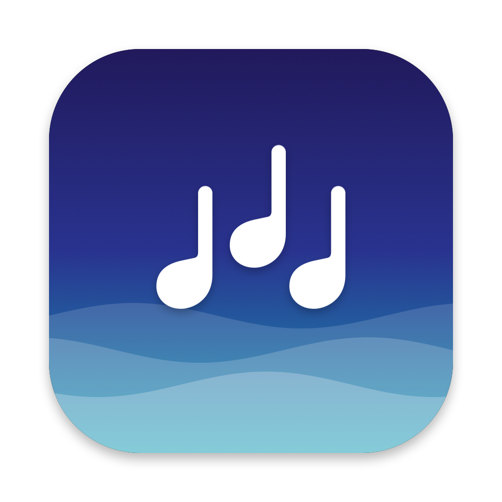
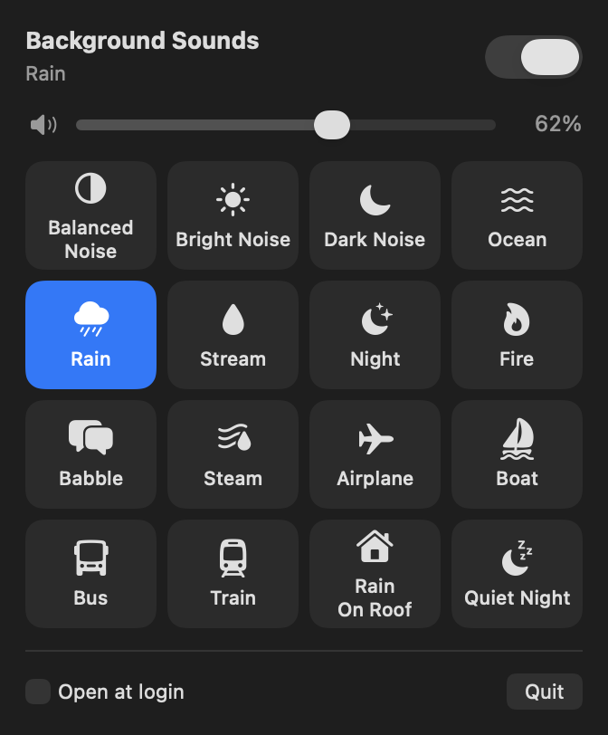

<p align="center"></p>

# BgSounds

macOS has lovely built-in Background Sounds (rain, ocean, fire, noise…), but changing the sound or its volume means digging through System Settings. BgSounds puts all of it one click away in the menu bar.

<p align="center"></p>

- Pick any of the 16 built-in sounds
- Volume slider
- On/off switch; the menu bar icon fades when sounds are off
- Optional open at login
- No downloads, no account, no network access

## Install

Paste this into Terminal:

```sh
curl -fsSL https://raw.githubusercontent.com/Waleed-Almutairi/BgSounds/main/install.sh | sh
```

It downloads the latest release, puts `BgSounds.app` in `/Applications` and opens it. Look for the three-notes icon in your menu bar. Run the same command again to update.

Needs macOS 13 or later. Works on Apple silicon and Intel.

> Why a Terminal command? The app isn't notarized by Apple, so a copy downloaded in a browser gets blocked as "unverified". If you download the zip from [Releases](https://github.com/Waleed-Almutairi/BgSounds/releases) instead, open System Settings → Privacy & Security and click **Open Anyway** after the first launch attempt.

## Uninstall

Click the menu bar icon, press **Quit**, then delete `BgSounds.app` from `/Applications`.

## Good to know

- **It uses undocumented Apple internals.** There is no public API for Background Sounds, so BgSounds calls the private `HearingUtilities` framework that System Settings itself uses. A macOS update can break it; that is also why it can't be on the Mac App Store.
- **Tested on macOS 26 (Apple silicon) only.** Older versions and Intel Macs should work but are untested. Please open an issue if something is off.
- **Sound quality.** BgSounds plays the copies of the sounds that ship with macOS. Picking a sound in System Settings switches back to Apple's higher-quality download.

## Build from source

Needs Xcode Command Line Tools (`xcode-select --install`).

```sh
git clone https://github.com/Waleed-Almutairi/BgSounds.git
cd BgSounds
./build.sh
open build/BgSounds.app
```

The whole app is one file: [`Sources/main.swift`](Sources/main.swift).

## License

MIT. Not affiliated with or endorsed by Apple.
